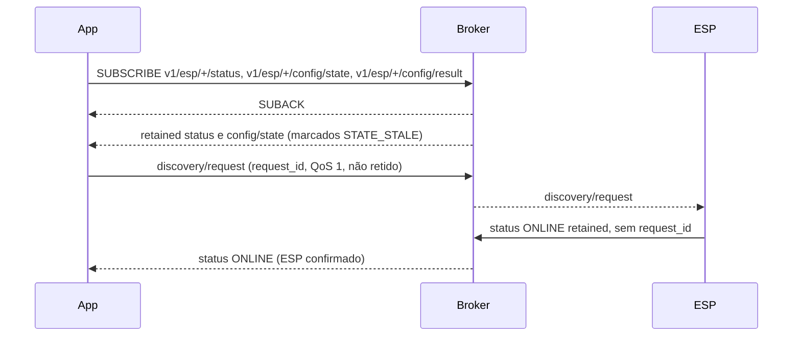
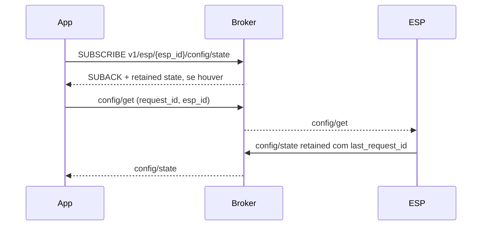
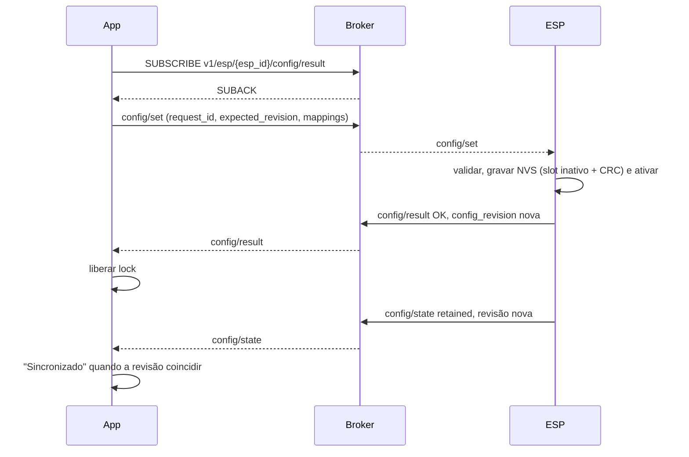
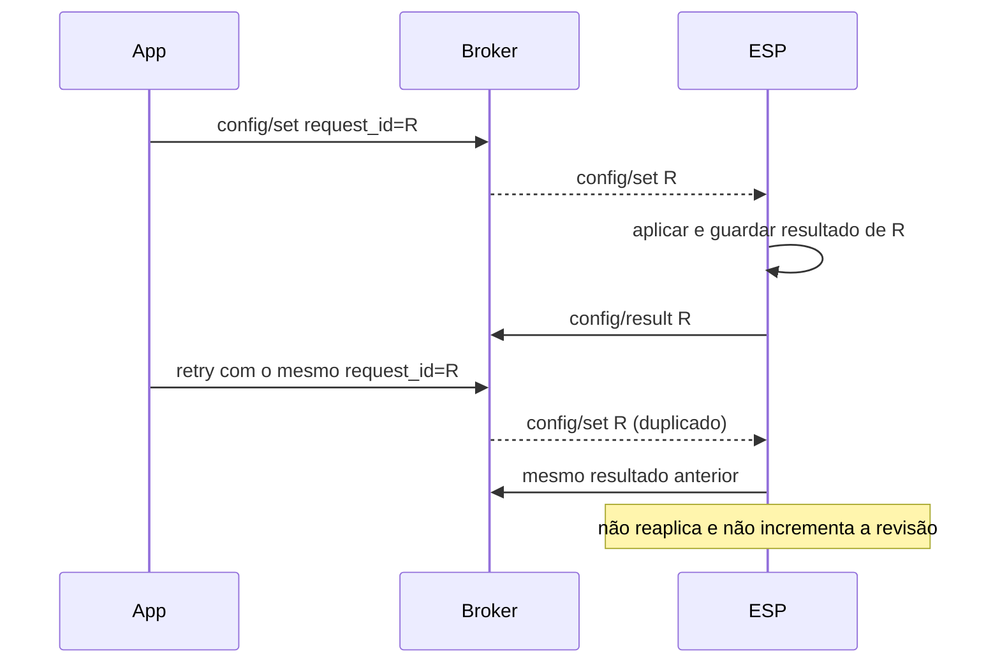
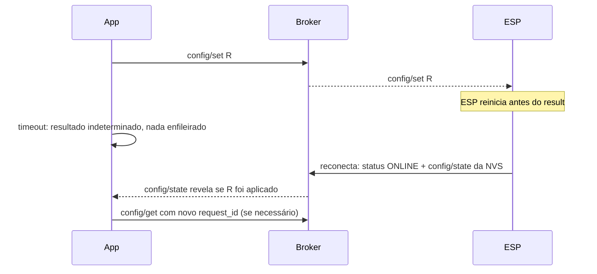
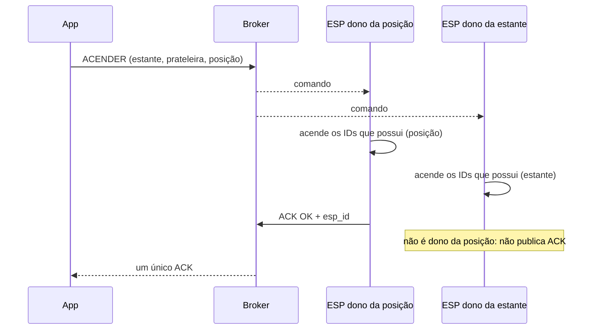
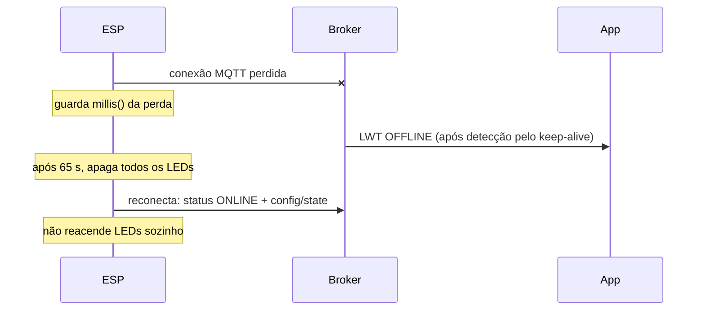

# Gerenciamento MQTT de ESP32 — MQTT 5 com fallback MQTT 3.1.1

> Especificação técnica vinculante, complementar a [`ESPECIFICACAO.md`](ESPECIFICACAO.md). Em caso de conflito sobre contratos legados, `ESPECIFICACAO.md` prevalece; para o gerenciamento de ESPs, MQTT 5 e firmware, este documento é a fonte da verdade.

## 1. Objetivo, escopo e fora de escopo

Esta especificação define o gerenciamento de ESP32 pelo app WMS Pick-by-Light. Cobre descoberta, leitura e alteração de mapeamentos, presença, compatibilidade MQTT 5/MQTT 3.1.1 e o firmware Arduino para LEDs discretos monocromáticos.

A configuração relaciona os IDs lógicos já existentes no domínio do app com canais digitais definidos no firmware. O app não escolhe GPIOs nem afirma que um LED está eletricamente conectado: o ESP informa os canais configurados e o mapeamento aplicado.

O payload JSON é a fonte da verdade nos dois protocolos. O MQTT 5 acrescenta propriedades úteis de transporte, diagnóstico e expiração, mas nenhum fluxo de negócio depende exclusivamente delas.

### 1.1 Fora de escopo

- Alterar contratos ou semântica dos comandos MQTT legados.
- Desativar o Poka-Yoke NFC ou alterar fluxos de estoque, operação manual ou homologação.
- Detectar eletricamente LED aberto, curto, desconexão ou intensidade luminosa.
- Expansores de GPIO (74HC595, MCP23017 etc.).
- Provisionamento Wi-Fi, OTA, backend, lock distribuído entre instalações do app.
- MQTT físico na Web/Wasm nesta entrega.
- TLS no protótipo. A decisão aceita o risco de credenciais e tráfego sem criptografia na rede local.
- Firmware ESP-IDF independente. O firmware desta entrega é compilado com Arduino IDE/`arduino-cli` e core Arduino-ESP32 pré-compilado.
- Fixar número de LEDs, cor dos LEDs, corrente de operação, modelo exato da DevKit ou número de locais da maquete antes do preenchimento das pendências (seção 17).

## 2. Glossário

- **ESP:** módulo ESP-WROOM-32 montado em placa de desenvolvimento (modelo na seção 17).
- **`esp_id`:** identidade estável no formato `esp-` + seis dígitos hexadecimais minúsculos, derivados do MAC de fábrica (eFuse).
- **Canal:** GPIO reservado pelo firmware para comandar um LED discreto. Tem `channel_id`, `gpio` e polaridade (`active_high`).
- **Mapping:** associação entre um ID lógico de LED do domínio WMS e um `channel_id`.
- **ID lógico:** `Estante.ledId`, `Prateleira.ledIdPonta` ou `Posicao.ledId`.
- **`config_revision`:** número monotônico persistido pelo ESP, incrementado após cada configuração aplicada com sucesso.
- **`boot_id`:** valor aleatório gerado com `esp_random` a cada inicialização.
- **Retained:** última mensagem retida pelo broker por tópico. É cache do último estado publicado, não prova de presença física atual.
- **LWT:** Last Will and Testament; mensagem que o broker publica quando a conexão do cliente cai de forma anormal.
- **QoS 1:** entrega ao menos uma vez; duplicatas são possíveis.
- **Clean Start / Clean Session:** conexão sem recuperar sessão MQTT anterior.
- **Estado possivelmente antigo (`STATE_STALE`):** snapshot recebido como retained, ainda sem confirmação na conexão atual.
- **`request_id`:** UUID por pedido de gerenciamento, usado para correlação e deduplicação.

## 3. Hardware

### 3.1 Módulo e placa

- **Módulo:** ESP-WROOM-32 (certificação MIC 211-161007), SoC ESP32-D0WDQ6, 4 MB de flash SPI, sem PSRAM. Confirmar a marcação do módulo físico antes de congelar o build.
- **Placa de desenvolvimento:** **[PREENCHER: DevKit 30 ou 38 pinos / modelo exato]**.
- **FQBN:** `esp32:esp32:esp32` (ESP32 Dev Module), flash 4 MB, tabela de partições padrão. Confirmar FQBN e opções contra a placa e o core instalado antes de congelar a compilação.

A documentação do módulo e do SoC não valida todas as placas vendidas como "DevKit": LED onboard, resistores, ligação USB-UART e pinos expostos variam por fabricante.

Fontes:
- Espressif, [ESP32-WROOM-32 Datasheet](https://www.espressif.com/sites/default/files/documentation/esp32-wroom-32_datasheet_en.pdf).
- Espressif, [ESP-IDF GPIO & RTC GPIO](https://docs.espressif.com/projects/esp-idf/en/latest/esp32/api-reference/peripherals/gpio.html).

### 3.2 Tabela normativa de GPIO

Aplica-se ao ESP32 clássico na variante ESP-WROOM-32 sem PSRAM.

| Classe                            | GPIOs                                                 | Regra                                                                                                                                                                                                                                                                                                     |
| --------------------------------- | ----------------------------------------------------- | --------------------------------------------------------------------------------------------------------------------------------------------------------------------------------------------------------------------------------------------------------------------------------------------------------- |
| **Recomendados (canais padrão)**  | 4, 13, 16, 17, 18, 19, 21, 22, 23, 25, 26, 27, 32, 33 | Saídas digitais livres, sujeitas à placa física. GPIO16/17 só são livres porque a variante não tem PSRAM (confirmar na placa). GPIO21/22 não são usados como I²C e GPIO25/26 não são usados como DAC neste firmware. A restrição de ADC2 com Wi-Fi vale para leituras analógicas, não para saída digital. |
| **Cautela (não usar por padrão)** | 2, 5, 14, 15                                          | GPIO2, 5 e 15 são strapping pins. GPIO5, 14 e 15 podem mudar de estado durante o boot, fazendo o LED piscar (regra preventiva, a validar na placa real). GPIO2 costuma ter LED onboard; se for usado, será `STATUS_LED_GPIO`, desligável, e **nunca** um canal configurável.                              |
| **Proibidos**                     | 0, 12                                                 | Strapping críticos. GPIO0 em nível baixo no reset seleciona modo download. GPIO12 (MTDI) em nível alto no reset pode selecionar tensão incompatível para a flash e impedir o boot. Não conectar LED, resistor de pull externo nem carga.                                                                  |
| **Proibidos**                     | 1, 3                                                  | UART0 TX/RX, reservados para gravação e log serial.                                                                                                                                                                                                                                                       |
| **Proibidos**                     | 6, 7, 8, 9, 10, 11                                    | Ligados à flash SPI interna do módulo.                                                                                                                                                                                                                                                                    |
| **Proibidos (somente entrada)**   | 34, 35, 36 (VP), 39 (VN)                              | Não têm driver de saída nem pull-up/pull-down interno.                                                                                                                                                                                                                                                    |

**Capacidade:** 14 canais recomendados por ESP. O firmware não ativa GPIOs de cautela por padrão.

Cada endereço físico usa três IDs lógicos (`Estante.ledId`, `Prateleira.ledIdPonta`, `Posicao.ledId`), mas estantes e prateleiras são compartilhadas entre posições. A demanda real é:

- `total_canais = nº_estantes + nº_prateleiras + nº_posições`
- `esps_mínimos = ceil(total_canais / 14)`

O cálculo não considera expansores, GPIOs de cautela nem pinos indisponíveis na placa.

Maquete: **[PREENCHER: nº de estantes, prateleiras e posições]**. Resultado: **[PREENCHER: total_canais e esps_mínimos]**.

### 3.3 Regras elétricas de montagem

- Lógica do ESP32: 3,3 V.
- Cada LED precisa de resistor em série, calculado pela cor, tensão direta (`Vf`) e corrente de projeto conservadora:

  `R = (3,3 V − Vf) / I`

- Dados pendentes: **[PREENCHER: cor e Vf dos LEDs]**, corrente de projeto por canal e quantidade máxima de LEDs acesos simultaneamente.
- LEDs azuis ou brancos (`Vf` ≈ 3 V) podem ficar fracos em 3,3 V. Nesse caso, usar transistor/driver alimentado em 5 V.
- Não usar valores máximos absolutos do datasheet como corrente de projeto. Conferir as características DC do SoC e da placa (corrente por GPIO e limite agregado) antes de ligar LEDs diretamente.
- Se a corrente simultânea se aproximar dos limites recomendados, usar transistor NPN, MOSFET ou ULN2803 por canal. Com driver, o firmware comuta o GPIO em nível alto (`active_high = true`).
- Polaridade por canal:
  - `ACTIVE_HIGH`: GPIO → resistor/driver → LED → GND; nível alto = LED aceso.
  - `ACTIVE_LOW`: 3V3 → LED → resistor → GPIO; nível baixo = LED aceso.
- GPIO0 e GPIO12 não recebem LED, resistor de pull nem carga.
- Não presumir que 14 LEDs acesos ao mesmo tempo, ligados direto nos GPIOs, sejam seguros: aprovar considerando simultaneidade e corrente total.

### 3.4 Modelo de canais e mappings

Canais são **constantes de compilação** do firmware. Cada canal tem:

- `channel_id`: `CH01` … `CH14`;
- `gpio`;
- `active_high`.

O app **nunca** envia GPIO, polaridade ou lista de canais. O firmware publica os canais reais em `status.capabilities.channels[]`.

No boot, o firmware valida a tabela de canais. GPIO proibido, duplicado ou fora das classes permitidas resulta em `CONFIG_INVALID` com todos os canais inativos. Aplicar `static_assert` quando a checagem puder ser feita em compilação; a validação em runtime continua obrigatória.

`config/set` carrega somente mappings:

```json
{ "led_id": "POS_A1_01", "kind": "POSICAO", "channel_id": "CH03" }
```

Regras:

1. `led_id` não vazio e único dentro do ESP.
2. O app compara os IDs de todos os ESPs conhecidos e bloqueia duplicação entre ESPs. Isso não prova exclusividade frente a ESPs offline ou desconhecidos.
3. Um `channel_id` atende no máximo um `led_id`.
4. `channel_id` precisa existir em `status.capabilities.channels`.
5. `kind` é `ESTANTE`, `PRATELEIRA` ou `POSICAO`.
6. O app valida o ID lógico contra `Estante.ledId`, `Prateleira.ledIdPonta` e `Posicao.ledId`, coerente com `kind`.
7. Um mapping não muda a semântica dos comandos legados.
8. `config/set` é sempre um snapshot completo de `mappings`, nunca um patch parcial.

### 3.5 Comportamento seguro sem broker

Se o ESP permanecer desconectado do broker por mais de **65 s**, apaga todos os LEDs. Ao reconectar, não reacende nada sozinho e aguarda um comando operacional novo.

A regra é local e independente do LWT e do timeout operacional do app. O firmware registra o instante da perda de conexão com `millis()`. Um reinício sempre começa no estado seguro, com tudo apagado.

## 4. MQTT 5 como melhoria, não dependência

### 4.1 Fonte da verdade

`request_id`, `esp_id`, `schema_version`, `expected_revision`, `boot_id`, `config_revision` e `uptime_ms` ficam no JSON onde definidos, mesmo quando parte deles também viaja em propriedades MQTT 5.

Se payload e propriedade MQTT 5 divergirem, **o payload prevalece** e o evento vai para log. Correlation Data é reforço; o `request_id` do payload é obrigatório.

`issued_at_ms` e `ttl_ms` são opcionais e apenas informativos. Não são validados como idade, porque o ambiente é local, sem Internet e sem NTP. Em MQTT 3.1.1, a proteção contra mensagens antigas vem de: sessão limpa, comandos não retidos, app sem fila tardia de `config/set`, `expected_revision` e deduplicação por `request_id`.

### 4.2 Recursos MQTT 5 e equivalentes MQTT 3.1.1

| Recurso MQTT 5                          | Uso                                                                                 | Conduta em MQTT 3.1.1                                                                                   | Dono / teste                                                                                                                             |
| --------------------------------------- | ----------------------------------------------------------------------------------- | ------------------------------------------------------------------------------------------------------- | ---------------------------------------------------------------------------------------------------------------------------------------- |
| Message Expiry Interval                 | Valores da tabela de tópicos (seção 5).                                             | Sem propriedade. Comandos não retidos, sessão limpa, sem fila de `config/set`, `ttl_ms` só informativo. | App define; broker expira; ESP não usa TTL como relógio. Testar entrega atrasada (v5) e ausência de replay (v3.1.1).                     |
| Response Topic                          | Somente `config/set` → `config/result`.                                             | `config/result` em tópico fixo por ESP.                                                                 | App assina antes de publicar. ESP só responde no Response Topic se ele for igual ao seu tópico `config/result`; senão usa o fixo e loga. |
| Correlation Data                        | Bytes UTF-8 do `request_id` em `config/set`/`config/result`.                        | `request_id` no JSON.                                                                                   | Payload é a fonte da verdade.                                                                                                            |
| Reason codes                            | Diagnóstico de CONNACK, PUBACK, SUBACK e DISCONNECT, quando entregues pelo cliente. | Códigos limitados da API, timeout e `error_code` do JSON.                                               | App apresenta e loga. Testar com a combinação real Paho/Mosquitto.                                                                       |
| Clean Start / Session Expiry            | Clean Start `true`, Session Expiry `0`.                                             | Clean Session `true`.                                                                                   | App e ESP. Testar desconexão e reconexão sem replay.                                                                                     |
| Will Delay                              | LWT do app e dos ESPs: 5 s configurado, sem efeito com Session Expiry 0 (ver 16, item 16). Keep-alive: 15 s. | LWT sem atraso padronizado.                                                                             | UI aceita OFFLINE com até ~30 s de atraso. Testar queda curta e longa.                                                                   |
| User Properties                         | Diagnóstico apenas (`schema_version`, `firmware_version`).                          | Não disponíveis; JSON e log.                                                                            | Nunca usadas em regra de domínio.                                                                                                        |
| Payload Format Indicator / Content Type | `1` e `application/json`.                                                           | JSON UTF-8 por contrato.                                                                                | Publicador garante; testar encoding.                                                                                                     |
| Maximum Packet Size / Receive Maximum   | Anunciar o limite suportado e poucas mensagens em voo.                              | Limites locais do firmware.                                                                             | ESP testa limites e heap.                                                                                                                |
| No Local                                | Ativar nas assinaturas do app quando aplicável.                                     | Filtrar publicações próprias por tópico/client ID.                                                      | Testar que `status/app` próprio não gera loop.                                                                                           |
| Subscription Identifiers                | Opcional, só diagnóstico/roteamento interno.                                        | Roteamento por tópico.                                                                                  | Sem regra funcional.                                                                                                                     |
| Server Keep Alive                       | Respeitar se o servidor enviar.                                                     | Keep-alive local.                                                                                       | Adapter.                                                                                                                                 |
| Assigned Client Identifier              | Não solicitar; IDs fixos e únicos.                                                  | Client ID explícito.                                                                                    | Testar que a reconexão mantém identidade.                                                                                                |
| Topic Alias                             | Descartado.                                                                         | —                                                                                                       | —                                                                                                                                        |
| Shared Subscriptions                    | Descartadas: discovery e comandos precisam chegar a todos os ESPs.                  | —                                                                                                       | Testar dois ESPs recebendo broadcast.                                                                                                    |

A compatibilidade exata de propriedades e reason codes deve ser verificada com Paho 1.2.5 e Mosquitto 2.1.2 durante a implementação. A existência de uma propriedade na norma não garante que o cliente ou o broker a usem.

### 4.3 Negociação e capacidades

O app oferece em Ajustes `Automático | 5.0 | 3.1.1`, persistido em DataStore (padrão: Automático).

- **Automático:** tenta MQTT 5. Se falhar por protocolo não suportado ou erro equivalente, fecha o cliente v5 e abre uma conexão nova MQTT 3.1.1.
- **5.0:** sem fallback; mostra erro se o MQTT 5 não for negociado.
- **3.1.1:** conecta direto em 3.1.1.
- O fallback é feito pelo adapter, com dois artefatos Paho. Não presumir fallback implícito no cliente Paho v5.
- `MqttService` preserva os membros atuais e passa a expor `negotiatedProtocol` e capacidades. A lógica comum consulta capacidades, sem `if (v5)` espalhado.
- O ESP segue o ADR-2.

## 5. Contrato de tópicos

`{esp_id}` segue `^esp-[0-9a-f]{6}$`, e o tópico e o payload precisam coincidir. Comandos e configuração nunca são retained; apenas status e estado são.

| Tópico                                                        | Direção                           |  QoS | Retain |                                                           Message Expiry v5 | Response Topic v5            | Payload e validações                                                                                                                                                                                  |
| ------------------------------------------------------------- | --------------------------------- | ---: | -----: | --------------------------------------------------------------------------: | ---------------------------- | ----------------------------------------------------------------------------------------------------------------------------------------------------------------------------------------------------- |
| `wms/pickbylight/comando`                                     | App → todos os ESPs               |    1 |    Não | `ACENDER` 5 s · `APAGAR` 65 s · `TESTE_LED` `duracao_ms` + 5 s · `PING` 5 s | Não                          | Payload legado intacto. O app pode **acrescentar** `request_id`, `issued_at_ms`, `ttl_ms` sem remover campos.                                                                                         |
| `wms/pickbylight/ack`                                         | ESP → App                         |    1 |    Não |                                                                           — | Não                          | ACK legado (`acao`, `posicao_led_id?`, `status`), com aditivos opcionais `esp_id`, `boot_id`, `request_id`, `error_code`. Para `PING`, o ESP responde `PONG` com `status: "OK"`, `esp_id`, `boot_id`. |
| `wms/pickbylight/status/app`                                  | App → Broker                      |    1 |    Sim |                                                                           — | Não                          | LWT do app inalterado: `client: "wms_mobile"`, `status: "OFFLINE"`. Will Delay 5 s em v5.                                                                                                             |
| `wms/pickbylight/v1/discovery/request`                        | App → todos os ESPs               |    1 |    Não |                                                                         3 s | Não                          | `schema_version`, `request_id`. Cada ESP republica seu status ONLINE (sem `request_id`).                                                                                                              |
| `wms/pickbylight/v1/esp/{esp_id}/status`                      | ESP → App                         |    1 |    Sim |                                                                           — | Não                          | Status ONLINE ou CONFIG_INVALID com `capabilities` e métricas (6.2). Sem `request_id`.                                                                                                                |
| `wms/pickbylight/v1/esp/{esp_id}/status` (LWT / desligamento) | Broker em nome do ESP / ESP → App |    1 |    Sim |                                                                           — | Não                          | Schema OFFLINE próprio (6.3): `reason: "LWT"` no Will, `reason: "SHUTDOWN"` no desligamento controlado. Will Delay 5 s em v5.                                                                         |
| `wms/pickbylight/v1/esp/{esp_id}/config/get`                  | App → ESP                         |    1 |    Não |                                                                         5 s | Não                          | `schema_version`, `esp_id`, `request_id`. O ESP republica `config/state` retained no tópico fixo com `last_request_id`.                                                                               |
| `wms/pickbylight/v1/esp/{esp_id}/config/state`                | ESP → App                         |    1 |    Sim |                                                                           — | Não                          | Snapshot aplicado (6.7).                                                                                                                                                                              |
| `wms/pickbylight/v1/esp/{esp_id}/config/set`                  | App → ESP específico              |    1 |    Não |                                                                         5 s | `.../{esp_id}/config/result` | Configuração desejada integral (6.6). Nunca enfileirada para envio tardio.                                                                                                                            |
| `wms/pickbylight/v1/esp/{esp_id}/config/result`               | ESP → App                         |    1 |    Não |                                                                        10 s | —                            | Confirmação ou rejeição (6.8).                                                                                                                                                                        |

Os comandos legados `ACENDER`, `APAGAR`, `PING`, `TESTE_LED`, o `ACK` e o LWT do app mantêm tópicos, campos e semântica.

### 5.1 Broadcast e propriedade dos IDs legados

- Em `ACENDER`/`APAGAR`, cada ESP opera **todos os IDs do payload que possui** e ignora os demais.
- **Somente o dono de `posicao_led_id` publica o ACK.** Os outros nunca publicam `ERRO`.
- `posicao_led_id` sem dono: nenhum ESP responde, e o app segue o timeout legado de 5 s e o Modo Manual.
- `TESTE_LED`: responde o dono de `posicao_led_id`; sem posição, o dono de `prateleira_led_id`; sem prateleira, o dono de `estante_led_id`.
- O ESP publica ACK também para `APAGAR`, mesmo que o app atual não o consuma (compatível com `ignoreUnknownKeys`).
- `PING`: todos os ESPs conectados respondem PONG. O primeiro conclui `enviarPing()`; os demais são ignorados pelo fluxo de latência (ver 16.4).
- Dois ESPs com o mesmo `led_id`: o app detecta conflito entre os ESPs conhecidos e bloqueia a gravação.
- `ACENDER`/`APAGAR` repetidos são idempotentes pelo estado do LED. `TESTE_LED` repetido reinicia o temporizador `duracao_ms`.
- `cor` continua no payload legado. O ESP aceita qualquer string, ignora o valor (log DEBUG opcional) e nunca rejeita por cor.

## 6. JSON Schemas

Os schemas usam JSON Schema Draft 2020-12 e são normativos para o namespace v1. Limites de tamanho: `config/set`, `config/state` e `status` ONLINE/CONFIG_INVALID até **2048 bytes** UTF-8 (o `status` carrega a lista de canais: 14 canais com métricas ≈ 940 bytes); demais payloads de gerenciamento até **512 bytes**. O tamanho é verificado antes do parse.

Convenções: UUIDs com `maxLength: 36`; `esp_id` com `^esp-[0-9a-f]{6}$`; `boot_id` com `^[0-9a-f]{8,32}$`; `channel_id` com `^CH[0-9]{2}$`.

### 6.1 `discovery/request`

```json
{
  "$schema": "https://json-schema.org/draft/2020-12/schema",
  "title": "DiscoveryRequest",
  "type": "object",
  "required": ["schema_version", "request_id"],
  "properties": {
    "schema_version": { "const": 1 },
    "request_id": { "type": "string", "format": "uuid", "maxLength": 36 }
  },
  "additionalProperties": false
}
```

- Válido: `{"schema_version":1,"request_id":"123e4567-e89b-12d3-a456-426614174000"}`
- Inválido: `{"schema_version":1}` (sem `request_id`).

### 6.2 Status ONLINE / CONFIG_INVALID

```json
{
  "$schema": "https://json-schema.org/draft/2020-12/schema",
  "title": "EspStatusOnline",
  "type": "object",
  "required": ["schema_version", "esp_id", "boot_id", "status", "capabilities", "config_revision"],
  "properties": {
    "schema_version": { "const": 1 },
    "esp_id": { "type": "string", "pattern": "^esp-[0-9a-f]{6}$" },
    "boot_id": { "type": "string", "pattern": "^[0-9a-f]{8,32}$" },
    "status": { "enum": ["ONLINE", "CONFIG_INVALID"] },
    "config_revision": { "type": "integer", "minimum": 0 },
    "capabilities": {
      "type": "object",
      "required": ["firmware_version", "mqtt_protocol", "channels"],
      "properties": {
        "firmware_version": { "type": "string", "minLength": 1, "maxLength": 32 },
        "mqtt_protocol": { "enum": ["5.0", "3.1.1"] },
        "channels": {
          "type": "array",
          "maxItems": 14,
          "items": {
            "type": "object",
            "required": ["channel_id", "gpio", "active_high"],
            "properties": {
              "channel_id": { "type": "string", "pattern": "^CH[0-9]{2}$" },
              "gpio": { "type": "integer", "minimum": 0, "maximum": 39 },
              "active_high": { "type": "boolean" }
            },
            "additionalProperties": false
          }
        }
      },
      "additionalProperties": false
    },
    "error_code": { "enum": ["INVALID_CHANNEL_TABLE", "STORAGE_FAILURE"] },
    "uptime_ms": { "type": "integer", "minimum": 0 },
    "rssi": { "type": "integer", "minimum": -127, "maximum": 0 },
    "free_heap": { "type": "integer", "minimum": 0 }
  },
  "allOf": [
    {
      "if": { "properties": { "status": { "const": "CONFIG_INVALID" } } },
      "then": { "required": ["error_code"] }
    }
  ],
  "additionalProperties": false
}
```

O limite numérico de `gpio` não autoriza nenhum pino: os canais são filtrados pela tabela 3.2. Com `CONFIG_INVALID`, `channels` pode vir vazio.

Válido:

```json
{
  "schema_version": 1,
  "esp_id": "esp-a1b2c3",
  "boot_id": "9f1a2b3c",
  "status": "ONLINE",
  "config_revision": 4,
  "capabilities": {
    "firmware_version": "1.0.0",
    "mqtt_protocol": "3.1.1",
    "channels": [
      { "channel_id": "CH01", "gpio": 4, "active_high": true },
      { "channel_id": "CH02", "gpio": 13, "active_high": true }
    ]
  },
  "uptime_ms": 120000,
  "rssi": -61,
  "free_heap": 182000
}
```

Inválido: `esp_id` em maiúsculas (`esp-A1B2C3`), ou `status: "CONFIG_INVALID"` sem `error_code`.

### 6.3 OFFLINE (LWT e desligamento controlado)

```json
{
  "$schema": "https://json-schema.org/draft/2020-12/schema",
  "title": "EspStatusOffline",
  "type": "object",
  "required": ["schema_version", "esp_id", "boot_id", "status", "reason"],
  "properties": {
    "schema_version": { "const": 1 },
    "esp_id": { "type": "string", "pattern": "^esp-[0-9a-f]{6}$" },
    "boot_id": { "type": "string", "pattern": "^[0-9a-f]{8,32}$" },
    "status": { "const": "OFFLINE" },
    "reason": { "enum": ["LWT", "SHUTDOWN"] }
  },
  "additionalProperties": false
}
```

O payload do Will é montado no CONNECT, sem campos dinâmicos, sempre com `reason: "LWT"`. No desligamento controlado, o ESP publica o mesmo formato com `reason: "SHUTDOWN"` antes de desconectar.

- Válido: `{"schema_version":1,"esp_id":"esp-a1b2c3","boot_id":"ab12cd34","status":"OFFLINE","reason":"LWT"}`
- Inválido: OFFLINE com `capabilities` ou `request_id`.

### 6.4 `config/get`

```json
{
  "$schema": "https://json-schema.org/draft/2020-12/schema",
  "title": "ConfigGet",
  "type": "object",
  "required": ["schema_version", "esp_id", "request_id"],
  "properties": {
    "schema_version": { "const": 1 },
    "esp_id": { "type": "string", "pattern": "^esp-[0-9a-f]{6}$" },
    "request_id": { "type": "string", "format": "uuid", "maxLength": 36 }
  },
  "additionalProperties": false
}
```

Inválido: `esp_id` do payload diferente do `{esp_id}` do tópico (o ESP ignora e loga).

### 6.5 Mapping (reutilizável)

```json
{
  "$schema": "https://json-schema.org/draft/2020-12/schema",
  "$id": "wms/pickbylight/v1/mapping",
  "type": "object",
  "required": ["led_id", "kind", "channel_id"],
  "properties": {
    "led_id": { "type": "string", "minLength": 1, "maxLength": 64 },
    "kind": { "enum": ["ESTANTE", "PRATELEIRA", "POSICAO"] },
    "channel_id": { "type": "string", "pattern": "^CH[0-9]{2}$" }
  },
  "additionalProperties": false
}
```

Regras que o schema não expressa: `led_id` e `channel_id` únicos no conjunto; canal existente nas capacidades; `led_id` existente no domínio do app.

### 6.6 `config/set`

```json
{
  "$schema": "https://json-schema.org/draft/2020-12/schema",
  "title": "ConfigSet",
  "type": "object",
  "required": ["schema_version", "esp_id", "request_id", "expected_revision", "mappings"],
  "properties": {
    "schema_version": { "const": 1 },
    "esp_id": { "type": "string", "pattern": "^esp-[0-9a-f]{6}$" },
    "request_id": { "type": "string", "format": "uuid", "maxLength": 36 },
    "expected_revision": { "type": "integer", "minimum": 0 },
    "issued_at_ms": { "type": "integer", "minimum": 0 },
    "ttl_ms": { "type": "integer", "minimum": 1, "maximum": 65000 },
    "mappings": {
      "type": "array",
      "maxItems": 14,
      "items": { "$ref": "wms/pickbylight/v1/mapping" }
    }
  },
  "additionalProperties": false
}
```

O app não envia `config_revision`, `boot_id` nem `uptime_ms`. `mappings: []` é válido e significa "nenhum LED mapeado neste ESP".

Válido:

```json
{
  "schema_version": 1,
  "esp_id": "esp-a1b2c3",
  "request_id": "123e4567-e89b-12d3-a456-426614174000",
  "expected_revision": 4,
  "mappings": [
    { "led_id": "EST_A_LED1", "kind": "ESTANTE", "channel_id": "CH01" },
    { "led_id": "PRAT_A1_LED1", "kind": "PRATELEIRA", "channel_id": "CH02" },
    { "led_id": "POS_A1_01", "kind": "POSICAO", "channel_id": "CH03" }
  ]
}
```

Inválidos (com o código esperado):

| Caso                                                             | Código                                                                                               |
| ---------------------------------------------------------------- | ---------------------------------------------------------------------------------------------------- |
| `channel_id: "CH99"` não reportado nas capacidades               | `UNKNOWN_CHANNEL`                                                                                    |
| Dois mappings com `channel_id: "CH03"`                           | `CHANNEL_CONFLICT`                                                                                   |
| Dois mappings com `led_id: "POS_A1_01"`                          | `LED_ID_CONFLICT`                                                                                    |
| `esp_id: "esp-ffffff"` no tópico `.../esp/esp-a1b2c3/config/set` | `ESP_ID_MISMATCH`                                                                                    |
| `expected_revision` diferente da revisão ativa                   | `REVISION_MISMATCH`                                                                                  |
| Payload acima de 2048 bytes                                      | `PAYLOAD_TOO_LARGE` (se o `request_id` não puder ser lido com segurança, descarta e loga, sem crash) |
| JSON malformado ou `schema_version` ≠ 1                          | `INVALID_SCHEMA`                                                                                     |

### 6.7 `config/state`

```json
{
  "$schema": "https://json-schema.org/draft/2020-12/schema",
  "title": "ConfigState",
  "type": "object",
  "required": ["schema_version", "esp_id", "boot_id", "config_revision", "mappings", "uptime_ms"],
  "properties": {
    "schema_version": { "const": 1 },
    "esp_id": { "type": "string", "pattern": "^esp-[0-9a-f]{6}$" },
    "boot_id": { "type": "string", "pattern": "^[0-9a-f]{8,32}$" },
    "config_revision": { "type": "integer", "minimum": 0 },
    "mappings": {
      "type": "array",
      "maxItems": 14,
      "items": { "$ref": "wms/pickbylight/v1/mapping" }
    },
    "uptime_ms": { "type": "integer", "minimum": 0 },
    "last_request_id": { "type": "string", "format": "uuid", "maxLength": 36 }
  },
  "additionalProperties": false
}
```

Inválido: estado sem `boot_id`, sem `config_revision` ou com `esp_id` divergente do tópico.

### 6.8 `config/result`

```json
{
  "$schema": "https://json-schema.org/draft/2020-12/schema",
  "title": "ConfigResult",
  "type": "object",
  "required": ["schema_version", "esp_id", "boot_id", "request_id", "status", "config_revision"],
  "properties": {
    "schema_version": { "const": 1 },
    "esp_id": { "type": "string", "pattern": "^esp-[0-9a-f]{6}$" },
    "boot_id": { "type": "string", "pattern": "^[0-9a-f]{8,32}$" },
    "request_id": { "type": "string", "format": "uuid", "maxLength": 36 },
    "status": { "enum": ["OK", "ERRO"] },
    "error_code": {
      "enum": [
        "REVISION_MISMATCH", "INVALID_SCHEMA", "LED_ID_CONFLICT",
        "UNKNOWN_CHANNEL", "CHANNEL_CONFLICT", "PAYLOAD_TOO_LARGE",
        "STORAGE_FAILURE", "EXPIRED", "ESP_ID_MISMATCH", "INTERNAL_ERROR"
      ]
    },
    "config_revision": { "type": "integer", "minimum": 0 },
    "message": { "type": "string", "maxLength": 160 }
  },
  "allOf": [
    {
      "if": { "properties": { "status": { "const": "OK" } } },
      "then": { "not": { "required": ["error_code"] } }
    },
    {
      "if": { "properties": { "status": { "const": "ERRO" } } },
      "then": { "required": ["error_code"] }
    }
  ],
  "additionalProperties": false
}
```

`config_revision` é sempre a revisão **ativa** após o processamento: a nova em OK e a vigente em ERRO.

- Válido OK: `{"schema_version":1,"esp_id":"esp-a1b2c3","boot_id":"ab12cd34","request_id":"123e4567-e89b-12d3-a456-426614174000","status":"OK","config_revision":5}`
- Válido ERRO: mesmo cabeçalho com `"status":"ERRO","error_code":"REVISION_MISMATCH","config_revision":5`
- Inválido: `status: "ERRO"` sem `error_code`.

### 6.9 Payloads legados (inalterados)

Estrutura atual conforme `app/shared/src/commonMain/kotlin/com/uniso/wms/pickbylight/data/mqtt/model/MqttPayloads.kt`:

```json
{"acao":"ACENDER","estante_led_id":"EST_A_LED1","prateleira_led_id":"PRAT_A1_LED1","posicao_led_id":"POS_A1_01","cor":"VERDE"}
{"acao":"APAGAR","estante_led_id":"EST_A_LED1","prateleira_led_id":"PRAT_A1_LED1","posicao_led_id":"POS_A1_01"}
{"acao":"PING"}
{"acao":"TESTE_LED","estante_led_id":"EST_A_LED1","prateleira_led_id":"PRAT_A1_LED1","posicao_led_id":"POS_A1_01","cor":"AZUL","duracao_ms":3000}
{"acao":"ACK","posicao_led_id":"POS_A1_01","status":"OK"}
{"client":"wms_mobile","status":"OFFLINE"}
```

Formatos aditivos novos (compatíveis com `ignoreUnknownKeys = true`; `MqttAck.status` continua obrigatório):

```json
{"acao":"ACK","posicao_led_id":"POS_A1_01","status":"OK","esp_id":"esp-a1b2c3","boot_id":"ab12cd34"}
{"acao":"PONG","status":"OK","esp_id":"esp-a1b2c3","boot_id":"ab12cd34"}
```

### 6.10 Propriedades MQTT 5 nas mensagens JSON

Payload Format Indicator = `1`; Content Type = `application/json`; User Properties apenas para diagnóstico. Em `config/set`: Response Topic = tópico `config/result` do mesmo ESP e Correlation Data = bytes do `request_id`. Se divergirem, o payload vence.

## 7. Códigos de erro

Usados em `config/result`:

| Código              | Significado                                                                                                                            |
| ------------------- | -------------------------------------------------------------------------------------------------------------------------------------- |
| `REVISION_MISMATCH` | `expected_revision` difere da revisão ativa.                                                                                           |
| `INVALID_SCHEMA`    | JSON malformado, versão ou estrutura não suportada.                                                                                    |
| `LED_ID_CONFLICT`   | `led_id` duplicado no snapshot.                                                                                                        |
| `UNKNOWN_CHANNEL`   | Canal pedido não existe nas capacidades.                                                                                               |
| `CHANNEL_CONFLICT`  | Canal atribuído a mais de um `led_id`.                                                                                                 |
| `PAYLOAD_TOO_LARGE` | Payload acima do limite.                                                                                                               |
| `STORAGE_FAILURE`   | Falha ao gravar/verificar NVS; a configuração anterior continua ativa.                                                                 |
| `EXPIRED`           | Reservado. Em v5 o broker descarta a mensagem expirada antes da entrega, e em 3.1.1 não há como medir idade. Não emitido nesta versão. |
| `ESP_ID_MISMATCH`   | `esp_id` do JSON difere do tópico.                                                                                                     |
| `INTERNAL_ERROR`    | Erro inesperado recuperável.                                                                                                           |

Usados em `status` com `CONFIG_INVALID`: `INVALID_CHANNEL_TABLE` (tabela de canais compilada inválida) e `STORAGE_FAILURE` (nenhum slot NVS válido no boot).

O ACK legado mantém `status: "OK" | "ERRO"` e pode trazer `error_code` aditivo em erros de execução. Cor desconhecida nunca é erro.

## 8. Diagramas de sequência

### 8.1 Abertura do gerenciamento e discovery



### 8.2 Leitura da configuração atual



### 8.3 Gravação bem-sucedida



### 8.4 `REVISION_MISMATCH`

```mermaid
sequenceDiagram
  participant A as App
  participant B as Broker
  participant E as ESP

  A->>B: config/set expected_revision=4
  B-->>E: config/set
  E->>B: config/result ERRO REVISION_MISMATCH, config_revision=5
  B-->>A: config/result
  A->>A: rejeitado; liberar lock
  A->>B: config/get (ação de recuperação)
  B-->>E: config/get
  E->>B: config/state revisão 5
  B-->>A: config/state
```

### 8.5 Duplicata QoS 1



### 8.6 ESP cai durante `config/set`



### 8.7 Comando legado com IDs em dois ESPs



### 8.8 Fallback para MQTT 3.1.1

```mermaid
sequenceDiagram
  participant A as App
  participant B as Broker

  A->>B: CONNECT MQTT 5 (modo Automático)
  B-->>A: recusa por protocolo ou falha equivalente
  A->>A: fechar cliente v5
  A->>B: nova conexão MQTT 3.1.1, Clean Session
  B-->>A: CONNACK sucesso
  A->>B: SUBSCRIBE e mensagens JSON v1
  Note over A,B: tópicos fixos; request_id no payload; sem propriedades v5
```

### 8.9 ESP sem broker por mais de 65 s



## 9. Responsabilidades do APP

### 9.1 Faz

- Mantém `MqttService` compatível: acrescenta `negotiatedProtocol`, capacidades e operações de gerenciamento sem alterar assinaturas existentes.
- Usa adapters Paho v3 e v5 coexistentes; Automático tenta v5 e cai para 3.1.1 em conexão nova.
- Usa Client ID estável por instalação (UUID persistido em DataStore, prefixo `wms_mobile_`).
- Assina tópicos e espera SUBACK antes de discovery, get e set.
- Descobre ESPs pelos retained de `status` mais o pedido explícito de discovery.
- Correlaciona `config/result` pelo `request_id` do payload; em v5, Correlation Data é reforço.
- Expõe estados UDF `Loading`, `Empty`, `Error`, `Success` e, por ESP, os estados da seção 9.3.
- Libera o lock ao receber `config/result`. Mostra "Sincronizado" só com `config/state` na revisão confirmada; se não chegar em 5 s, mostra "Aplicado — aguardando estado" e oferece `config/get` manual.
- Persiste em DataStore (Android), como JSON versionado, o inventário de ESPs e o último snapshot conhecido, sempre exibido como possivelmente antigo (STALE) até confirmação na conexão atual. Wasm sem persistência da feature (ADR-6).
- Persiste em DataStore o modo de protocolo e as credenciais MQTT; nunca no código-fonte. A resolução da URL do broker continua: parâmetro → DataStore → `BuildConfig.MQTT_BROKER_URL`.
- Valida antes de publicar: formato dos IDs; existência em `Estante.ledId`/`Prateleira.ledIdPonta`/`Posicao.ledId` coerente com `kind`; unicidade de `led_id` entre ESPs conhecidos; unicidade de `channel_id`; canal existente nas capacidades; tamanho ≤ 2048 bytes.
- Mantém um lock global de configuração, separado de `Item.emSeparacao`, que vale nos dois sentidos na mesma instância: enquanto um ESP é configurado, impede iniciar separação e editar outro ESP; com uma coleta ativa, impede gravar configuração (evita trocar o mapping de um LED aceso no meio da coleta). É liberado em resultado, rejeição, cancelamento, timeout (5 s sem `config/result`), desconexão e fim da coleta. Não coordena outros aparelhos.
- Oferece telas: lista de ESPs, detalhe (canais, protocolo, firmware, revisão), edição de mappings (só canais livres) e "Testar LED".
- "Testar LED" publica `TESTE_LED` legado, nunca `config/set` (ver 16.5).
- Respeita a UI existente: toque ≥ 48 dp, botões primários ≥ 56 dp, texto ≥ 16 sp, breakpoints e feedback háptico atual.
- Descarta respostas com `boot_id` antigo, revisão inferior à conhecida, `request_id` desconhecido ou tópico/payload divergentes.
- Mantém a fila/retry existente **apenas** para comandos operacionais.

### 9.2 Nunca faz

- Publicar GPIO ou inferir canal físico.
- Tratar PUBACK como confirmação de aplicação.
- Exibir ausência de resposta como "configuração vazia".
- Publicar comando ou configuração com retain.
- Reenviar `config/set` com `request_id` novo como retry da mesma operação.
- Interpretar `issued_at_ms`/`ttl_ms` como prova de idade.
- Remover campos ou semântica dos comandos legados.
- Desativar a validação NFC ou o Modo Manual.

### 9.3 Estados

- Tela: `Loading` (aguardando SUBACK/snapshot), `Empty` (nenhum ESP após a janela de discovery de 3 s), `Error` (broker, schema ou persistência), `Success`.
- Por ESP: `ONLINE`, `OFFLINE`, `STATE_STALE`, `WAITING_RESULT`, `APPLIED_WAITING_STATE`, `REJECTED(error_code)`, `TIMEOUT`, `CONFIG_INVALID`.
- Status retained sem confirmação na conexão atual é `STATE_STALE`, não ONLINE.
- Na Web/Wasm, a tela mostra "Gerenciamento de ESPs indisponível na versão Web".

### 9.4 Testes do app

Ver seção 14.1.

## 10. Responsabilidades do ESP

### 10.1 Arquivo e toolchain

- Arquivo único `esp32/esp32.ino` (a IDE Arduino exige pasta e arquivo com o mesmo nome).
- O cabeçalho declara: módulo, FQBN, opções de flash/partição, versão do core Arduino-ESP32, versão do ArduinoJson 7.x, caminho MQTT adotado (v5+fallback ou 3.1.1) e a evidência do `sdkconfig`.
- Sem biblioteca de LED: `pinMode`, `digitalWrite`, `millis`.
- Credenciais em placeholders: `<WIFI_SSID>`, `<WIFI_PASSWORD>`, `<MQTT_HOST>`, `<MQTT_PORT>`, `<MQTT_USER>`, `<MQTT_PASSWORD>`.
- Seções comentadas, nesta ordem: (1) configuração e constantes; (2) identidade; (3) GPIO/canais; (4) Wi-Fi; (5) MQTT; (6) protocolo/JSON; (7) persistência NVS; (8) comandos legados; (9) gerenciamento v1; (10) diagnóstico.

### 10.2 MQTT no firmware

- `PubSubClient` só suporta 3.1.1 e não é usado.
- Usar o cliente ESP-MQTT (`mqtt_client.h`) do ESP-IDF embutido no core Arduino-ESP32.
- MQTT 5 só é habilitado se `CONFIG_MQTT_PROTOCOL_5=y` for comprovado no `sdkconfig` do core instalado. Caso contrário, o firmware opera em 3.1.1 e o contrato JSON continua funcional.
- Não migrar para ESP-IDF nesta entrega.
- Fontes: [ESP-MQTT Kconfig](https://github.com/espressif/esp-mqtt/blob/master/Kconfig) (`CONFIG_MQTT_PROTOCOL_5` com default `n`) e [ESP-MQTT Programming Guide](https://docs.espressif.com/projects/esp-mqtt/en/latest/esp32/index.html).
- Assinaturas: `wms/pickbylight/comando`, `wms/pickbylight/v1/discovery/request`, `wms/pickbylight/v1/esp/{esp_id}/config/get`, `wms/pickbylight/v1/esp/{esp_id}/config/set`.
- Conexão: Client ID = `esp_id`, Clean Session/Start, keep-alive 15 s, Will retained no tópico de status (6.3).

### 10.3 Boot, máquina de estados e concorrência

Primeira ação do `setup()`, antes de Wi-Fi, MQTT e NVS:

1. validar a tabela constante de canais;
2. configurar cada GPIO válido como `OUTPUT`;
3. escrever o nível inativo conforme `active_high`.

Depois, máquina de estados não bloqueante `BOOT → WIFI_CONNECTING → MQTT_CONNECTING → ONLINE`, com backoff exponencial com jitter e watchdog ativo.

- Proibido `delay()` longo no `loop()` ou em callbacks. `TESTE_LED` desliga por `millis()`.
- Callbacks MQTT não fazem parse pesado, acesso à NVS nem `digitalWrite`: apenas copiam o payload (já limitado em tamanho) para uma fila FreeRTOS de capacidade fixa.
- Como o ESP-MQTT roda em task própria, a fila é a única passagem de mensagens. Configuração, NVS e GPIO têm um único dono (a task do `loop()`). Indicadores compartilhados usam atômicos ou mutex.
- Fila cheia: descartar a mensagem e logar WARN (o app trata por timeout).

### 10.4 Identidade e status

- `esp_id` vem do MAC de fábrica (`esp_efuse_mac_get_default`), não do MAC da interface Wi-Fi. O mesmo valor é usado no Client ID, nos tópicos e no JSON.
- `boot_id`: 8 dígitos hexadecimais de `esp_random()` a cada boot.
- `config_revision`: monotônica e persistida; nunca diminui. Incrementa só após persistência confirmada. Tipo `uint32_t` (rollover fora do horizonte do protótipo, documentado).

Ao conectar:

1. publicar `status` retained (`ONLINE`, ou `CONFIG_INVALID` com `error_code`) com capacidades, `config_revision` e métricas;
2. publicar `config/state` retained da configuração ativa;
3. não acender LED automaticamente.

Republicar status a cada discovery e a cada 60 s (heartbeat de métricas). LWT: OFFLINE retained com `reason: "LWT"`, Will Delay 5 s em v5. Desligamento controlado: OFFLINE com `reason: "SHUTDOWN"`.

### 10.5 NVS e aplicação de configuração

Persistência com `Preferences` em dois slots:

1. gravar o snapshot no slot inativo;
2. reler e validar tamanho, schema e CRC32;
3. atualizar o seletor do slot ativo por último;
4. manter o slot anterior válido até o commit.

Processamento de `config/set`:

1. verificar o tamanho antes do parse;
2. validar schema, `esp_id`, `expected_revision`, canais existentes, unicidade de `led_id` e de `channel_id`;
3. checar o cache de `request_id` (últimos 8, em RAM): se repetido, republicar o mesmo resultado e parar;
4. persistir (seção acima) → trocar a configuração ativa → incrementar a revisão;
5. publicar `config/result OK` e depois `config/state` retained.

Regras de falha:

- Falha de NVS: `STORAGE_FAILURE`; mantém a configuração anterior ativa e não mexe nos LEDs.
- Nenhum slot válido no boot: `CONFIG_INVALID` com `STORAGE_FAILURE`, todos os LEDs apagados, sem crash.
- LEDs mapeados a canais que deixaram de ter mapping são apagados ao trocar a configuração.
- O cache de deduplicação não é persistido: reaplicar um snapshot igual após reboot falha por `REVISION_MISMATCH` ou é idempotente.
- Ao reiniciar, a NVS é a fonte da configuração; o retained do broker é apenas cache.

### 10.6 Comandos legados

- Operar todos os IDs do payload que existem nos mappings locais.
- ESP que não possui nenhum ID do payload não publica nada.
- ACK somente do dono de `posicao_led_id` (`ACENDER`, `APAGAR`, `TESTE_LED`); em `TESTE_LED` sem posição, o dono da prateleira e depois o da estante.
- `PING`: publicar `{"acao":"PONG","status":"OK","esp_id":"esp-xxxxxx","boot_id":"..."}`. Nunca PONG sem `status`.
- Meta: ACK em menos de 500 ms após receber a mensagem. A meta ponta a ponta de 2 s (app → LED) é medida no teste E2E.
- `ACENDER`/`APAGAR` são idempotentes pelo estado lógico; `TESTE_LED` repetido reinicia o temporizador.
- `cor`: aceita qualquer string e ignora.
- JSON inválido em `comando`: descartar e logar, sem ACK.

### 10.7 Canais, offline e diagnóstico

- `channels[]` vem das constantes compiladas: `CH01`…`CH14` nos GPIOs recomendados, na ordem da tabela 3.2. A quantidade pode ser reduzida conforme a placa.
- Tabela inválida: todos os LEDs inativos e status `CONFIG_INVALID` (`INVALID_CHANNEL_TABLE`) quando houver MQTT.
- Mais de 65 s sem broker: apagar todos os canais; ao reconectar, permanecer apagado até novo `ACENDER` ou `TESTE_LED`.
- Log serial com níveis ERROR/WARN/INFO/DEBUG selecionáveis por constante. Nunca logar senhas.
- Limites: 2048 bytes para set, state e status ONLINE/CONFIG_INVALID; 512 bytes para os demais. Documento JSON de capacidade fixa; todo `deserializeJson` tem o retorno verificado.
- `STATUS_LED_GPIO` (GPIO2) é desligado por padrão (constante `USE_STATUS_LED = false`).

## 11. Matriz de responsabilidades

| Preocupação           | App                                                                    | ESP                                        | Broker                                        | Garantido por                      |
| --------------------- | ---------------------------------------------------------------------- | ------------------------------------------ | --------------------------------------------- | ---------------------------------- |
| Identidade            | Confere `esp_id` de tópico e payload; Client ID estável por instalação | ID do MAC de fábrica; Client ID = `esp_id` | Unicidade de Client ID por conexão (takeover) | Validação dupla + teste de colisão |
| Presença              | Retained = `STATE_STALE` até confirmação                               | ONLINE, LWT OFFLINE, SHUTDOWN              | Guarda retained e publica LWT                 | `boot_id`, `uptime_ms`, LWT        |
| Schema                | Valida ao publicar e ao receber                                        | Valida em runtime com limites              | Limite de pacote do listener                  | App + firmware                     |
| Revisão               | Envia `expected_revision`; confere a revisão retornada                 | Compara, persiste, incrementa              | Transporte                                    | Firmware                           |
| Deduplicação          | Retry reutiliza o mesmo `request_id`                                   | Cache dos últimos 8 `request_id`           | QoS 1 pode duplicar                           | App + ESP                          |
| Expiração             | Propriedade v5; não envia set offline                                  | Não usa TTL como relógio                   | Expira mensagens v5                           | Broker (v5) + disciplina (3.1.1)   |
| Persistência          | Room (snapshot) e DataStore (prefs)                                    | NVS em dois slots + CRC                    | Retained é cache                              | App / ESP                          |
| Mapeamento            | IDs do domínio → canais anunciados                                     | Canal → `digitalWrite`                     | Transporte                                    | App + firmware                     |
| Conflito de IDs       | Entre ESPs conhecidos                                                  | Dentro do próprio ESP                      | Não garante                                   | App (limitado a ESPs conhecidos)   |
| Timeout               | 5 s ACK operacional; 5 s `config/result`; 5 s estado                   | 65 s offline → apagar                      | Keep-alive / Will Delay                       | App + ESP + broker                 |
| Retry                 | Fila só para operacionais; config sem fila                             | Backoff de reconexão                       | Retransmissão QoS 1                           | App + ESP                          |
| Lock                  | Lock local de configuração                                             | —                                          | —                                             | App (limitado à instalação)        |
| ACL                   | Usuário `wms_app`                                                      | Usuário próprio `esp-xxxxxx`               | ACL por tópico                                | Broker                             |
| Compatibilidade 3.1.1 | Tópicos fixos e payload completo                                       | JSON idêntico                              | Aceita v5 e 3.1.1                             | Testes nos dois protocolos         |
| Corrente / GPIO       | —                                                                      | Inativo no boot; tabela validada           | —                                             | Hardware + firmware + bancada      |

## 12. Broker (Mosquitto 2.1.2)

Exemplo de ACL (`acl_file`), a validar no broker. O nome de usuário de cada ESP é igual ao seu `esp_id`:

```text
# App
user wms_app
topic readwrite wms/pickbylight/#

# ESPs (%u = usuário = esp_id)
pattern read  wms/pickbylight/comando
pattern write wms/pickbylight/ack
pattern read  wms/pickbylight/v1/discovery/request
pattern write wms/pickbylight/v1/esp/%u/status
pattern write wms/pickbylight/v1/esp/%u/config/state
pattern write wms/pickbylight/v1/esp/%u/config/result
pattern read  wms/pickbylight/v1/esp/%u/config/get
pattern read  wms/pickbylight/v1/esp/%u/config/set
```

- `allow_anonymous false` e `password_file` configurados.
- Listener TCP local sem TLS (risco aceito).
- `max_packet_size` ≥ 4096 no listener.

## 13. ADRs

### ADR-1 — Cliente MQTT do app

- **Contexto:** `gradle/libs.versions.toml` usa `org.eclipse.paho:org.eclipse.paho.client.mqttv3:1.2.5`, e `PahoMqttServiceImpl.kt` importa `org.eclipse.paho.client.mqttv3.*`. O Client ID atual é `WmsMobile_${currentTimeMillis()}`.
- **Decisão:** Paho v3 e v5 (`org.eclipse.paho:org.eclipse.paho.mqttv5.client:1.2.5`) coexistem no Android, com adapters separados selecionados por `Automático | 5.0 | 3.1.1`. Client ID passa a ser UUID estável por instalação.
- **Alternativa:** manter só v3.1.1 (menor risco, sem propriedades v5).
- **Consequências:** `MqttService` ampliado sem quebra; testes nos dois adapters (LWT, retry, reconexão). O v3 só sai após decisão futura.

### ADR-2 — MQTT do ESP

- **Contexto:** `PubSubClient` não suporta MQTT 5. O ESP-MQTT suporta, mas `CONFIG_MQTT_PROTOCOL_5` tem default `n`.
- **Decisão:** Arduino IDE/`arduino-cli` com core pré-compilado e ESP-MQTT. Se o `sdkconfig` do core comprovar `CONFIG_MQTT_PROTOCOL_5=y`, habilitar v5 com fallback 3.1.1; senão, firmware em 3.1.1.
- **Alternativa:** Arduino como componente ESP-IDF (fora do escopo).
- **Consequência:** o contrato JSON funciona nos dois casos; MQTT 5 no ESP não é afirmado sem evidência de build e de bancada.

### ADR-3 — Saídas de LED

- **Contexto:** LEDs discretos monocromáticos, um por GPIO.
- **Decisão:** sem biblioteca de LED; canais constantes de compilação com polaridade; `pinMode`/`digitalWrite`/`millis`.
- **Alternativa:** driver externo por canal (permitido como circuito).
- **Consequência:** até 14 canais por ESP; sem RGB, brilho ou fita.

### ADR-4 — Sessões e expiração

- **Contexto:** sem Internet/NTP; um set antigo não pode ser reaplicado.
- **Decisão:** Clean Start/Clean Session, Session Expiry 0, escritas nunca retidas, app sem fila de `config/set`, Message Expiry em v5 conforme a seção 5; em 3.1.1, sessão limpa, revisão e idempotência.
- **Alternativa:** sessão persistente (rejeitada, pois reentregaria comandos antigos).
- **Consequência:** mensagens publicadas com o destinatário desconectado são perdidas por projeto.

### ADR-5 — Persistência no app

- **Contexto:** `RoomWmsRepositoryImpl` e `WmsDatabase` existem em androidMain, mas o Room nunca foi ativado (sem KSP/room-compiler, banco nunca instanciado); o app usa `InMemoryWmsRepository` também no Android. `BrokerUrlDataStore` guarda URL, protocolo e Client ID.
- **Decisão:** inventário de ESPs e último snapshot em DataStore, serializados como JSON versionado, no mesmo arquivo de preferências. Wasm sem persistência da feature.
- **Alternativa:** ativar o Room só para ESPs (rejeitada: exige toolchain nova, KSP compatível com Kotlin 2.4.20, para poucos ESPs × 14 mappings).
- **Consequência:** sem entidade, DAO ou migration; os dados de ESP ficam fora do repositório operacional, então o reset de demo não os apaga. Mudança de formato exige incrementar a versão do JSON; versão desconhecida ou JSON corrompido são ignorados com log.

### ADR-6 — Web/Wasm

- **Contexto:** `MqttServiceProvider.wasmJs.kt` retorna `FakeMqttService`; Paho Java não roda em Wasm.
- **Decisão:** manter o Fake; a tela de ESPs informa indisponibilidade na Web.
- **Alternativa:** MQTT via WebSocket (fora desta entrega).
- **Consequência:** a Web não configura hardware real nesta fase.

## 14. Plano de testes

### 14.1 App

Comandos (Windows, conforme `.antigravityrules`):

```text
cmd /c "gradlew.bat :app:shared:testAndroidHostTest --rerun-tasks & echo EXITCODE=%ERRORLEVEL%"
cmd /c "gradlew.bat :app:androidApp:assembleDebug & echo EXITCODE=%ERRORLEVEL%"
```

Os 10 cenários de `HomologacaoCenariosTest.kt` permanecem verdes, sem enfraquecer asserções. A contagem total de testes nunca cai abaixo da linha de base medida antes da implementação.

Novos testes em `commonTest` (`FakeMqttService` + Turbine):

1. seleção de protocolo e fallback automático;
2. correlação pelo payload, com e sem Correlation Data;
3. duplicata QoS 1 com o mesmo `request_id`;
4. resposta com `boot_id` antigo descartada;
5. `REVISION_MISMATCH`;
6. timeout não vira "configuração vazia";
7. lock liberado em sucesso, rejeição, timeout, cancelamento e desconexão;
8. lock bloqueia início de separação;
9. conflito de `led_id` entre ESPs conhecidos;
10. ACK legado e ACK aditivo desserializados;
11. PONG com `status: "OK"` conclui `enviarPing()`; PONGs extras não quebram;
12. SUBACK precede discovery/get/set;
13. reason code `0x10 No matching subscribers` exibido só como diagnóstico;
14. validação de mappings (canal inexistente, duplicado, tamanho);
15. Client ID estável entre reconexões;
16. Wasm mostra indisponibilidade sem tentar Paho;
17. persistência do inventário de ESPs testada (ida e volta do JSON, JSON corrompido/versão desconhecida ignorados, reset de demo não apaga).

Integração opcional com Mosquitto 2.1.2, desativada por padrão e ativada por propriedade Gradle explícita: conexão v5 e 3.1.1, retain, expiry, Response Topic, Correlation Data, ACL e reason codes efetivamente entregues.

### 14.2 Compilação e revisão estática do ESP

```text
cmd /c "arduino-cli compile --fqbn esp32:esp32:esp32 esp32 --warnings all & echo EXITCODE=%ERRORLEVEL%"
```

Registrar FQBN, versão do core e das bibliotecas, uso de flash/RAM, warnings e o valor de `CONFIG_MQTT_PROTOCOL_5`.

Checklist estático:

- [ ] nenhum `delay()` longo no `loop()` ou em callbacks;
- [ ] nenhuma `String` dinâmica em caminho quente;
- [ ] nenhuma credencial real;
- [ ] tamanho verificado antes de todo parse; retorno de todo `deserializeJson` tratado;
- [ ] nenhum GPIO proibido ou duplicado na tabela de canais;
- [ ] `setup()` deixa todos os canais inativos antes de Wi-Fi/MQTT/NVS;
- [ ] callback apenas enfileira;
- [ ] watchdog ativo;
- [ ] NVS em dois slots com CRC;
- [ ] todo caminho de erro termina em estado seguro.

### 14.3 Roteiro de bancada

Executar em MQTT 5 (`-V mqttv5`) e em MQTT 3.1.1 (`-V mqttv311`) com `mosquitto_pub`/`mosquitto_sub`. Substituir `<BROKER>`, `<ESP_ID>` e credenciais; não deixar senha no histórico do shell. O detalhamento comando a comando fica em `esp32/TESTES_BANCADA.md`.

1. **Boot:** status ONLINE e `config/state` retained publicados; `boot_id` muda a cada reset.
2. **Corte de energia:** LWT OFFLINE após detecção pelo keep-alive (~1,5 × 15 s), em v5 e em 3.1.1 (Will Delay sem efeito, ver 16, item 16). Medir queda curta e longa e registrar se há OFFLINE seguido de ONLINE ("pisca").
3. **Discovery:** status republicado, sem `request_id`.
4. **`config/get`:** `config/state` no tópico fixo com `last_request_id`.
5. **`config/set` válido:** OK, revisão +1, novo state retained; persiste após reboot.
6. **Revisão errada:** `REVISION_MISMATCH`; nada muda.
7. **Duplicata:** mesmo resultado, uma única aplicação.
8. **Inválidos:** JSON malformado, `esp_id` divergente, canal inexistente, canal duplicado, `led_id` duplicado, payload acima do limite → erro enumerado, sem reboot.
9. **Expiração v5:** `config/set` com Message Expiry 2 s com o ESP offline; ligar após 2 s → não aplicado. Em 3.1.1: sessão limpa impede replay.
10. **Comandos próprios:** `ACENDER`/`APAGAR`/`TESTE_LED` → LED correto, ACK OK em menos de 500 ms; `TESTE_LED` apaga sozinho.
11. **ID de outro ESP:** nenhum LED e nenhum ACK.
12. **PING:** PONG no formato da seção 10.6.
13. **Reconexão:** reiniciar o broker e derrubar o Wi-Fi → backoff, sem crash, status/state republicados.
14. **Estresse:** 100 comandos seguidos e 24 h ligado; `free_heap` sem queda contínua; sem resets.
15. **Casos 1–12 em MQTT 3.1.1.**
16. **Cada canal:** acionar CH01…CHnn e conferir o LED físico.
17. **Boot seguro:** todos os LEDs apagados antes de Wi-Fi/MQTT.
18. **Sem piscar:** observar os canais padrão desde o reset.
19. **Tabela inválida:** build de teste com GPIO proibido/duplicado → `CONFIG_INVALID` (`INVALID_CHANNEL_TABLE`), tudo apagado.
20. **Offline 65 s:** LED aceso, broker desligado por mais de 65 s → apaga; ao reconectar, continua apagado.
21. **Cor ignorada:** `cor` desconhecida em `ACENDER`/`TESTE_LED` → executa normalmente, ACK OK.
22. **IDs em 2 ESPs:** estante no ESP A e posição no ESP B → os dois LEDs acendem, um único ACK (do ESP B).

### 14.4 Ponta a ponta

Com app e ESP reais, repetir os cenários homologados 3, 4, 5, 6 e 8 e confirmar:

- o LED físico corresponde ao `led_id`;
- erro/timeout continua levando ao Modo Manual;
- o Poka-Yoke NFC continua ativo e `modoManual` continua gravado;
- o lock de configuração bloqueia a separação só enquanto necessário;
- a reconexão do broker não reenvia configuração antiga;
- latência app → LED abaixo de 2 s.

## 15. Riscos e mitigações

| Risco                                 | Mitigação                                                   | Teste                                                   |
| ------------------------------------- | ----------------------------------------------------------- | ------------------------------------------------------- |
| Paho v5 quebra reconexão, LWT ou fila | Adapters separados; v3 mantido                              | Queda de broker, reconexão e LWT em cada protocolo      |
| Sessão antiga reentrega comandos      | Clean Start/Session; sem retain                             | Publicar com destino offline e reconectar               |
| Retained antigo exibido como verdade  | `STATE_STALE` até confirmação                               | Retained antigo com ESP desligado                       |
| Client ID duplicado                   | UUID por instalação; MAC no ESP                             | Duas instâncias com o mesmo ID                          |
| Broadcast gera ACK múltiplo ou `ERRO` | Só o dono da posição responde                               | 2 ESPs, exatamente 1 ACK                                |
| Dois ESPs com o mesmo `led_id`        | Bloqueio entre ESPs conhecidos                              | Estado duplicado injetado                               |
| `if (v5)` espalhado                   | Adapter + capacidades; JSON fonte da verdade                | Mesmos casos nos dois protocolos                        |
| Payload maior que o buffer            | Limite antes do parse; fila limitada                        | 2048 (set/state/status) / 512 bytes e acima             |
| Callback disputa estado com o loop    | Fila única; um dono de NVS/GPIO                             | Estresse e revisão estática                             |
| 3.1.1 sem relógio                     | Não depender de TTL                                         | Broker offline e reconexão                              |
| Retained apagado por engano           | Nenhuma ação de limpeza na UI operacional                   | Verificar que nenhum fluxo publica payload vazio retido |
| Wasm sem cliente físico               | Fake + mensagem                                             | Build Wasm                                              |
| Strapping impede o boot               | GPIO0/12 proibidos; cautela fora do padrão                  | Reset repetido com LEDs ligados                         |
| LED pisca no boot                     | Canais padrão sem strapping; inativo no início do `setup()` | Observação desde o reset                                |
| Corrente excessiva                    | Resistor, cálculo de simultaneidade, driver                 | Medir corrente/temperatura na carga máxima              |
| NVS corrompida                        | Dois slots + CRC                                            | Corte de energia durante gravação                       |
| Reset de demo apaga ESPs              | Tabelas separadas                                           | Reset preservando mappings                              |
| Regressão homologada                  | Contratos legados intocados                                 | Suíte completa + E2E                                    |
| Credenciais sem TLS                   | Risco aceito; ACL; rede controlada                          | Nenhuma credencial real no código                       |

## 16. Decisões sobre divergências do código atual

1. **Paho:** hoje só existe o v3. A integração do v5 é trabalho novo (ADR-1).
2. **ACK:** `MqttAck` ganha campos opcionais `espId`, `bootId`, `requestId`, `errorCode` (nomes JSON `esp_id`, `boot_id`, `request_id`, `error_code`). `status` continua obrigatório.
3. **Tópicos:** `MqttTopics` ganha as constantes/funções do namespace `wms/pickbylight/v1/...`; `COMANDO`, `ACK` e `STATUS_APP` não mudam.
4. **PING com vários ESPs:** `enviarPing()` mantém a chave única `pendingAcks["PING"]`; o primeiro PONG conclui e os demais são ignorados sem erro. A contagem de ESPs vem do discovery, não do PING.
5. **`testarLed()`:** o comportamento atual (sucesso também em timeout) é preservado para não afetar fluxos existentes. Para a tela de ESPs, adicionar o método novo `testarLedComConfirmacao(...)`, que retorna se houve ACK OK, ERRO ou timeout. A tela mostra "Sem confirmação do ESP" quando houver timeout.
6. **`apagarLed()`:** continua sem aguardar ACK; o ESP envia o ACK mesmo assim, e o app o ignora.
7. **Lock:** novo `ConfigLock` global; `SeparacaoViewModel` consulta o lock antes de iniciar a coleta e continua usando `Item.emSeparacao`.
8. **Persistência:** o Room não está ativo no projeto (ver ADR-5). O inventário de ESPs e o snapshot vão em JSON no DataStore, ao lado das chaves de protocolo e Client ID de `BrokerUrlDataStore`. Credenciais seguem adiadas (item 15).
9. **Client ID:** passa de `WmsMobile_${currentTimeMillis()}` para `wms_mobile_<uuid>` persistido.
10. **Backoff:** mantido como está no código (1/2/4/8/16 s, até 5 tentativas); qualquer mudança exige decisão separada.
11. **Firmware:** não existe hoje; `esp32/esp32.ino` é criado do zero.
12. **README:** além da linha 3 (WS2812B → LEDs discretos), recebe uma seção nova com broker/ACL, toolchain do ESP, ligação dos LEDs e link para `esp32/TESTES_BANCADA.md`. Os exemplos de comando passam a ter a forma Windows (`gradlew.bat`).
13. **GPIO16/17, GPIO5/14/15 e corrente:** regras preventivas, confirmadas na placa real durante a bancada (casos 16–18) e pela medição de corrente.
14. **Recebimento v1 tolerante:** o app decodifica `status`, `config/state` e `config/result` ignorando chaves desconhecidas (um firmware mais novo pode acrescentar campos sem quebrar o app). Continuam inválidos (`INVALID_SCHEMA`): campo obrigatório ausente, enum desconhecido, `request_id` em `status`, `capabilities` ou `request_id` em OFFLINE. A validação de `config/set`, `config/get` e `discovery/request` (espelho do ESP) segue estrita, pois os schemas têm `additionalProperties: false`.
15. **Autenticação adiada:** o broker do protótipo roda sem usuário, senha ou ACL. A seção 12 fica como configuração-alvo para uma fase posterior. O app e o firmware devem funcionar com credenciais **vazias** (conexão anônima). As credenciais são opcionais em toda a implementação, e nenhum fluxo pode exigi-las.
16. **Will Delay com Session Expiry 0 (decisão A):** pela norma MQTT 5, o Will é publicado quando o Will Delay vence ou quando a sessão termina, o que vier primeiro. Com Session Expiry 0 (ADR-4), a sessão termina na queda e o OFFLINE sai sem atraso: o Will Delay de 5 s continua configurado, mas não tem efeito. O OFFLINE aparece após a detecção pelo keep-alive (~1,5 × 15 s ≈ 22 s), dentro da tolerância de ~30 s da UI. Instabilidade curta de Wi-Fi pode gerar OFFLINE seguido de ONLINE. Usar Session Expiry maior que 0 exigiria Clean Start `false` na reconexão, em conflito com o ADR-4; a opção só será reavaliada se a bancada mostrar "pisca" relevante.


## 17. Pendências `[PREENCHER]`

- [ ] DevKit 30 ou 38 pinos / modelo exato.
- [ ] Número de estantes, prateleiras e posições da maquete.
- [ ] `total_canais` e `esps_mínimos`.
- [ ] Cor e `Vf` dos LEDs.
- [ ] Corrente de projeto por canal e quantidade máxima de LEDs acesos simultaneamente.
- [ ] Versão do core Arduino-ESP32 e valor comprovado de `CONFIG_MQTT_PROTOCOL_5`.
- [ ] Versão exata do ArduinoJson 7.x.
- [ ] Limite de mappings confirmado por RAM/flash (padrão: 14).
- [ ] Uso de GPIO2 como `STATUS_LED_GPIO` (padrão: não usar).